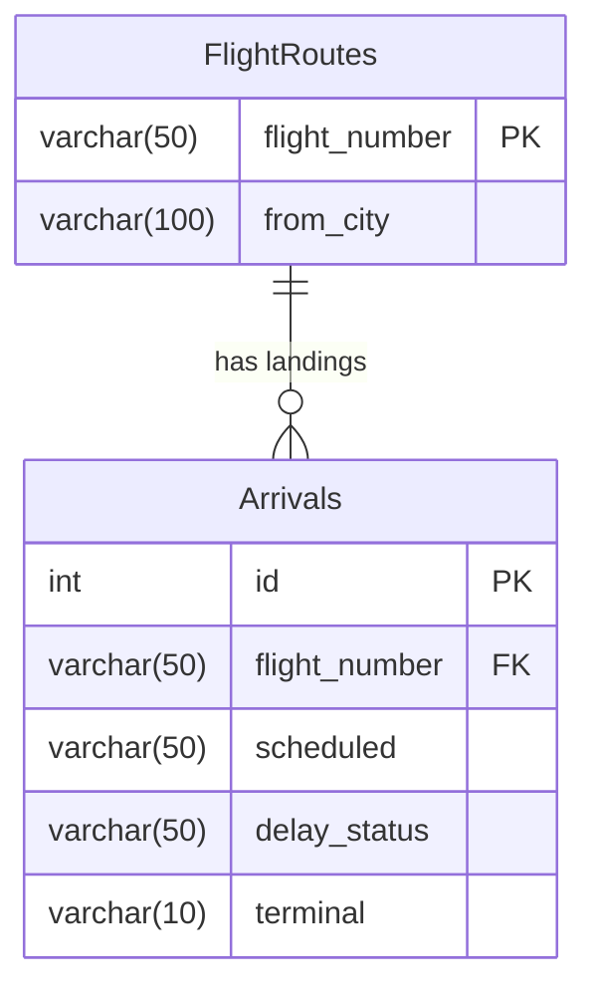

# Flight Arrivals Management System (`JDBC_FlightManager`)

**Course:** Software Engineering Methods (Academic Year 2026–2027)  
**Institution:** Braude College of Engineering | Department of Software Engineering  
**Database Engine:** MySQL 8.0+ | **Language:** Java 25 LTS (JDBC)

---

## 1. Project Description
This project implements the Data Access Layer (DAL) of an airport flight arrivals management system. Raw landing data (`arrived_flights.csv`, 299 records) was imported into MySQL as a flat table (`rawflights`), analyzed for functional dependencies, and normalized into Third Normal Form (3NF) as two related tables: `FlightRoutes` and `Arrivals`. The Java application uses JDBC with try-with-resources to display a joined arrivals board (`FlightManagerBase`), update a single flight status (`SimpleFlightUpdater`), perform batched updates with a `PreparedStatement` (`AdvancedFlightDispatcher`), and filter arrivals by terminal (`FlightViewer`). As part of a security exercise, a live SQL Injection attack was performed against a vulnerable `Statement`, and the code was then refactored into a secure `PreparedStatement` with Javadoc. Most of the code was generated with a local AI assistant (Continue + Qwen2.5-Coder) and reviewed manually.

---

## 2. Engineering Team Details (Single-Workstation Driver–Navigator)

| Name                   | College e-mail                      |ID|
|----------------------- |-------------------------------------|---------|
| Lior Shor              | Lior.Shor@e.braude.ac.il            |212272793|
| Guy Gabi Kikozashvili  | Guy.Gabi.Kikozashvil@e.braude.ac.il |324096403|
| Amir Kosover           | Amir.Kosover@e.braude.ac.il         |212131296|


* **GitHub Repository URL:** `https://github.com/[GuyKiko]/JDBC_FlightManager`

---

## 3. Technology Stack
* **Runtime & JDK:** BellSoft Liberica Full JDK 25 LTS
* **Database Server:** MySQL Server 8.0+ (`FlightDB` schema)
* **JDBC Driver:** MySQL Connector/J 9.5.0 (`mysql-connector-j-9.5.0.jar`)
* **IDE & Database Tooling:** IntelliJ IDEA Ultimate (Built-in Database Console & SQL Generator)
* **Local AI Assistant:** LM Studio (`Qwen2.5-Coder-7B-Instruct`) integrated via the Continue plugin
* **Version Control:** Git & GitHub

---

## 4. Database Normalization (3NF) & Functional Dependencies ($F$)

### 4.1 Functional Dependencies ($F$) in `rawflights`
The flat table `rawflights(scheduled, flight, fromC, delay, terminal)` represents landing events. A landing event is identified by the flight together with its scheduled time, so the key is `{flight, scheduled}`. The dependencies are:
* $\text{flight} \rightarrow \text{fromC}$: a flight number uniquely determines its departure city.
* $\{\text{flight}, \text{scheduled}\} \rightarrow \text{delay}, \text{terminal}$: the status and terminal belong to a specific landing event.

### 4.2 Why `rawflights` Violated 3NF
The non-key attribute `fromC` depends only on `flight`, not on the full key of the landing event. As a result, the departure city is repeated for every landing of the same flight, which creates redundancy and the following anomalies:
* **Update anomaly:** changing a flight's departure city requires updating every one of its rows, and missing a row leaves the data inconsistent.
* **Insertion anomaly:** a new route (flight + departure city) cannot be stored until the flight has at least one landing.
* **Deletion anomaly:** deleting a flight's last landing also deletes the only record of its departure city.

Formally, `flight → fromC` is a *partial dependency* on the key `{flight, scheduled}`, so `rawflights` is not even in 2NF, and therefore not in 3NF.

Decomposing the table so that `fromC` is stored once per flight removes all three anomalies.

### 4.3 Decomposed 3NF Relational Schema
* **`FlightRoutes`** (`flight_number` VARCHAR(50) **PK**, `from_city` VARCHAR(100) NOT NULL): one row per flight route.
* **`Arrivals`** (`id` INT AUTO_INCREMENT **PK**, `flight_number` VARCHAR(50) NOT NULL **FK**, `scheduled` VARCHAR(50), `delay_status` VARCHAR(50), `terminal` VARCHAR(10)): one row per landing event.
* **Foreign Key:** `Arrivals.flight_number` → `FlightRoutes.flight_number` with `ON DELETE CASCADE`, which enforces referential integrity.

---

## 5. Independent AI Prompt (Part 4 – `FlightViewer.java`)

```text
Write a complete Java class named FlightViewer with a main method.
Use Scanner to ask for the MySQL root password, then ask the user to enter a target terminal number (valid values: 2, 3, 4, 5). Read both inputs with scanner.nextLine().
Connect to MySQL using DriverManager with URL: "jdbc:mysql://localhost:3306/FlightDB?allowLoadLocalInfile=true&allowPublicKeyRetrieval=true&serverTimezone=Asia/Jerusalem&useSSL=false" and user "root".
Use try-with-resources for Connection, PreparedStatement and ResultSet.
Use a secure PreparedStatement with a '?' placeholder to execute this query:
SELECT a.id, a.flight_number, r.from_city, a.scheduled, a.delay_status, a.terminal FROM Arrivals a INNER JOIN FlightRoutes r ON a.flight_number = r.flight_number WHERE a.terminal = ? ORDER BY a.scheduled ASC
The terminal column is VARCHAR(10), so bind the parameter with pstmt.setString(1, terminal) and NOT setInt.
Print the results as a formatted table using System.out.printf with a header row and fixed column widths (make the city column at least 20 characters wide).
After the table, print the total number of flights found for that terminal. If no rows are found, print a clear message.
Catch SQLException and print the error code and message.
Import every class you use.
```

---

## 6. Entity Relationship Diagram (ERD)



---

## 7. Security Audit Summary (Part 5 – SQL Injection Mitigation)
* **Attack Payload Tested:** `Landed' #`
* **Vulnerability Analysis (`Statement`):** The original `SimpleFlightUpdater` built the query by string concatenation, so the payload produced `UPDATE Arrivals SET delay_status = 'Landed' #' WHERE flight_number = 'LX354'`. The single quote closed the string literal early, and `#` started a MySQL single-line comment that disabled the `WHERE` clause. The statement therefore updated all 299 rows in `Arrivals`.
* **Remediation (`PreparedStatement`):** The code was refactored to `UPDATE Arrivals SET delay_status = ? WHERE flight_number = ?` with `setString()` bindings inside try-with-resources. The query structure is compiled before any user input is bound, and bound values are always treated as data, never as SQL code. After the fix, the same payload updated only flight LX354, storing the literal text `Landed' #`, and the other 298 rows remained intact.

---

## 8. License
Distributed under the **Braude College Academic License** (Software Engineering Methods, 2026–2027).
